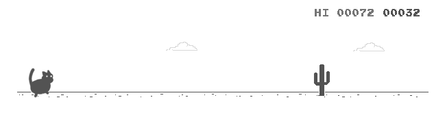

### Hi Friend 👋

<!--
**eltsai/eltsai** is a ✨ _special_ ✨ repository because its `README.md` (this file) appears on your GitHub profile.

Here are some ideas to get you started:

- 🔭 I’m currently working on ...
- 🌱 I’m currently learning ...
- 👯 I’m looking to collaborate on ...
- 🤔 I’m looking for help with ...
- 💬 Ask me about ...
- 📫 How to reach me: ...
- 😄 Pronouns: ...
- ⚡ Fun fact: ...
-->

<!--

-->

🌱 Hi! I'm [Elisa](https://eltsai.github.io/). I ~~am a 1st 2nd 3rd 4th 5th year CSE Ph.D. student~~ received my Ph.D. in Computer Science and Engineering from the University of Michigan, advised by Professor [Atul Prakash](https://web.eecs.umich.edu/~aprakash/). I am currently a software engineer at Google.

We humans extracted silicon from sand and built circuits that perform arithmetic with 0s and 1s. We use these circuits to train and serve models that attempt to capture the statistical structure of the world. I’m interested in understanding how these models learn, reason, and generalize. My current work focuses on making this faster and with less computation.

Misc:
- [📝 Blogs](https://etsai.site/) (primarily in Chinese)
- [🎵 dumblelisa@Soundcloud](https://soundcloud.com/dumblelisa)
- [🎵 网易云](https://music.163.com/#/artist?id=12158117)
- [🎨 Random drawing](https://etsai.site/tags/comics/)
- [‍🎓 Academic Homepage](https://eltsai.github.io/)

My avatar is Tangyuan, and he goes by Tang-Tang. 🐈

